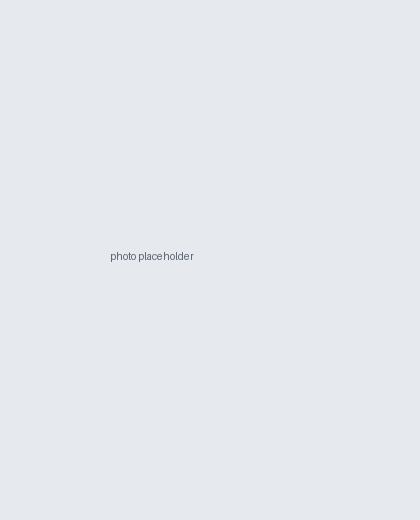

<!-- TODO : copier votre photo depuis l'ancien site vers assets/buste.jpg -->
{.portrait alt="Portrait d'Ari Rappaport"}

Je suis chercheur postdoctoral au [Laboratoire Jacques-Louis Lions](https://www.ljll.fr/) (Sorbonne Université / CNRS) à Paris, financé par une bourse ERC Synergy. <!-- TODO : nom du projet + lien -->

Mes recherches se situent à l'interface de l'**analyse numérique** et du **calcul scientifique**, avec un accent sur la **propagation d'ondes électromagnétiques à haute fréquence dans des milieux complexes et anisotropes**. Je travaille sur les **méthodes de décomposition de domaine** pour les équations de Maxwell en régime harmonique — leur conception, leur analyse de convergence explicite en fréquence, et leur mise en œuvre parallèle à grande échelle — en m'appuyant sur l'**analyse semiclassique** comme cadre explicatif du comportement de ces solveurs.

Avant de rejoindre le LJLL, j'étais postdoctorant dans l'équipe [POEMS](https://uma.ensta-paris.fr/poems/) à l'ENSTA Paris, où j'ai travaillé avec Patrick Ciarlet, Axel Modave et Théophile Chaumont-Frelet. J'ai effectué ma thèse à Sorbonne Université et Inria Paris au sein de l'équipe [SERENA](https://team.inria.fr/serena/), sous la direction de Martin Vohralík et François Févotte, sur les méthodes d'éléments finis adaptatives et les solveurs pour les EDP elliptiques non linéaires.

## Contact

- Courriel : <!-- TODO : adresse LJLL actuelle -->
- Bureau : Laboratoire Jacques-Louis Lions, Sorbonne Université, 4 place Jussieu, 75005 Paris
- [GitHub](https://github.com/aerappa) · [Google Scholar](https://scholar.google.com/citations?user=FIbOGQEAAAAJ&hl=fr) · [HAL](https://hal.science/search/index/?q=ari+rappaport) · [LinkedIn](https://www.linkedin.com/in/ari-rappaport-642559108/)
