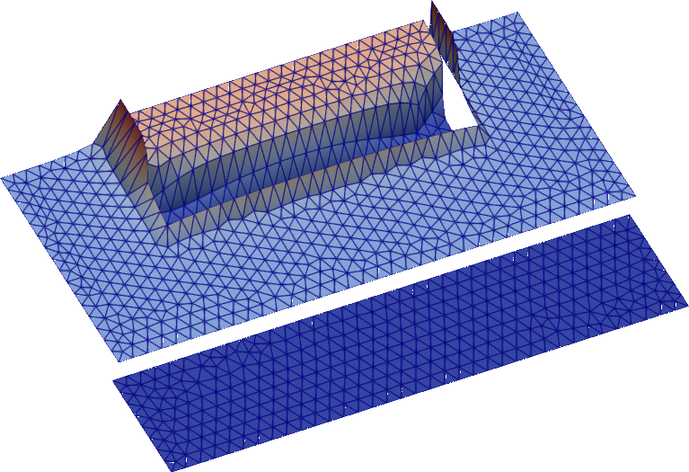
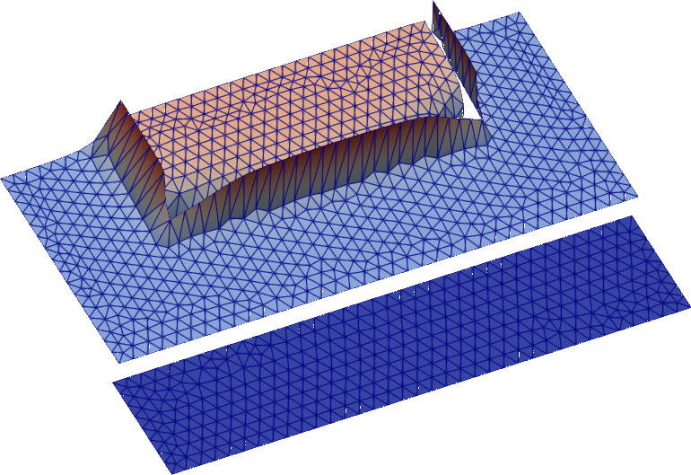
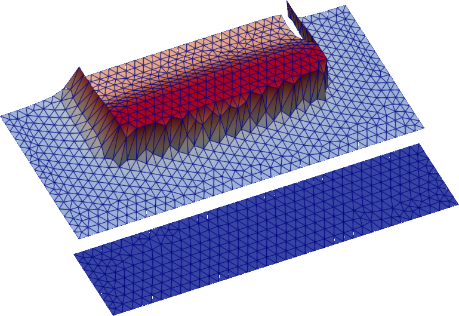

Je développe et analyse des méthodes numériques pour les équations aux dérivées partielles. Je m’intéresse particulièrement aux interactions entre **discrétisation et résolution itérative** : comment les choix effectués dans la formulation d’une méthode numérique déterminent le problème algébrique, et comment l’analyse mathématique permet d’expliquer et d’améliorer le solveur obtenu.

Mes recherches actuelles portent principalement sur la propagation des ondes à haute fréquence. Elles prolongent mes travaux récents sur les discrétisations et les méthodes de décomposition de domaine pour les équations de Maxwell en régime harmonique, et m’amènent aujourd’hui vers les méthodes dans l’espace des phases pour la diffraction acoustique et électromagnétique.

## Discrétisations et solveurs pour les ondes électromagnétiques

### Méthodes de Galerkine discontinues hybridables

Avec [Théophile Chaumont-Frelet](https://tchaumont.github.io/) et [Axel Modave](https://www.axel.modave.eu/), j’ai étendu la **méthode CHDG**, initialement étudiée pour l’équation de Helmholtz, aux équations de Maxwell harmoniques en trois dimensions à coefficients constants.

La méthode utilise des variables de transmission entrantes et sortantes sur les faces des éléments. L’élimination des champs à l’intérieur de chaque élément conduit à un système global portant sur les variables entrantes aux interfaces. Nous démontrons que les problèmes locaux sont bien posés et que l’itération de point fixe associée est contractante.

L’article présente également une implémentation nodale et compare des stratégies de résolution par CGNR et GMRES sur des cas tests tridimensionnels, dont une expérience à grande échelle avec un code C++ parallèle. Je prépare la publication de **CHDG.jl** sur GitHub.

::: {.research-figure}
{.research-image alt="Champ électromagnétique tridimensionnel calculé avec la méthode CHDG."}

*Champ électromagnétique tridimensionnel calculé avec la méthode CHDG.*
:::

Publication associée : [A Hybridizable Discontinuous Galerkin Method with Transmission Variables for Time-Harmonic Electromagnetic Problems](https://doi.org/10.1137/25M1756818), *SIAM Journal on Scientific Computing* (2026) · [Version HAL](https://hal.science/hal-05016261).

### Décomposition de domaine pour les milieux hétérogènes et anisotropes

Dans des travaux menés à [POEMS](https://uma.ensta-paris.fr/poems/) avec [Marcella Bonazzoli](https://mbonazzo.gitlabpages.inria.fr/), [Patrick Ciarlet Jr.](https://perso.ensta-paris.fr/~ciarlet/eng_index.html) et [Axel Modave](https://www.axel.modave.eu/), j’ai étudié un **préconditionneur de Schwarz additif à deux niveaux** pour les équations de Maxwell harmoniques à coefficients matériels anisotropes et variables en espace.

Nous établissons des estimations de convergence de GMRES préconditionné qui font apparaître explicitement le contraste matériel et l’anisotropie. L’analyse couvre une conductivité proportionnelle à la permittivité et une classe restreinte d’écarts à ce cas. Les expériences numériques à fréquence fixée montrent qu’un raffinement du maillage grossier peut largement compenser la dégradation de la convergence liée à l’augmentation de l’anisotropie ou de l’hétérogénéité. Elles montrent aussi un bon comportement du solveur pour des conductivités au-delà des conditions suffisantes de l’analyse.

::: {.research-figure}
::: {.ddm-crop}
{alt="Visualisations de champs issues des expériences sur les équations de Maxwell hétérogènes et anisotropes."}
:::

*Visualisations de champs issues des expériences sur les équations de Maxwell hétérogènes et anisotropes.*
:::

Prépublication associée : [Analysis of a two-level domain decomposition preconditioner for the time-harmonic Maxwell equations in anisotropic media](https://hal.science/hal-05572507).

Ces deux projets abordent une même question sous des angles complémentaires : CHDG étudie comment une discrétisation peut faire apparaître une structure itérative utile, tandis que les travaux en décomposition de domaine analysent comment un préconditionneur et un espace grossier gouvernent la convergence du solveur obtenu.

## Méthodes dans l’espace des phases pour les ondes à haute fréquence

J’ai récemment rejoint le [LJLL](https://www.ljll.fr/) pour travailler sur les **méthodes dans l’espace des phases** au sein du projet ERC Synergy **[PSINumScat](https://psinumscat.com/)** (Phase-space-inspired Numerical Methods for High Frequency Wave Scattering), financé par le Conseil européen de la recherche (convention de subvention [n° 101167139](https://doi.org/10.3030/101167139)).

Le projet vise à utiliser les outils mathématiques de l’analyse à haute fréquence pour concevoir, analyser et implémenter de nouvelles méthodes numériques pour la diffraction d’ondes acoustiques et électromagnétiques. Cette nouvelle direction prolonge mon intérêt pour les relations entre la structure d’un problème d’ondes, sa formulation numérique et les performances du solveur.

## Travaux antérieurs : estimation d’erreur a posteriori et adaptivité

Pendant ma thèse, j’ai étudié comment des **estimations d’erreur a posteriori** peuvent orienter l’effort de calcul dans les problèmes elliptiques non linéaires et non lisses. Les estimateurs distinguent les erreurs de régularisation, de linéarisation et de discrétisation, ce qui permet de guider le raffinement du maillage et de choisir les critères d’arrêt à chaque étape du calcul.

Avec [François Févotte](https://fevotte.net/) et [Martin Vohralík](https://who.rocq.inria.fr/Martin.Vohralik/), j’ai développé des stratégies de régularisation adaptative fondées sur ce principe, notamment pour l’équation de Richards décrivant les écoulements en milieu poreux. Des travaux avec [A. Harnist](https://andreharnist.fr/), [K. Mitra](https://www.koondi.net/) et Martin Vohralík établissent des estimations robustes en énergie augmentée pour les problèmes elliptiques lipschitziens et fortement monotones.

Publications associées : [Régularisation adaptative pour l’équation de Richards](https://hal.science/hal-04266827) · [Régularisation, discrétisation et linéarisation adaptatives pour les problèmes non lisses](https://hal.science/hal-04105560) · [Estimations robustes en énergie augmentée](https://hal.science/hal-04033438).

::: {.research-figure}
::: {.research-sequence}
{alt="Première étape de la simulation de la nappe perchée"}

{alt="Deuxième étape de la simulation de la nappe perchée"}

{alt="Troisième étape de la simulation de la nappe perchée"}
:::

*Évolution d’une nappe perchée dans une simulation de l’équation de Richards.*
:::

Le volet numérique de ces travaux comprend **EquilibratedFlux.jl** et des travaux avec François Févotte sur une [implémentation parallèle par threads de la reconstruction de flux équilibrés en Julia](https://hal.science/hal-04537446).
