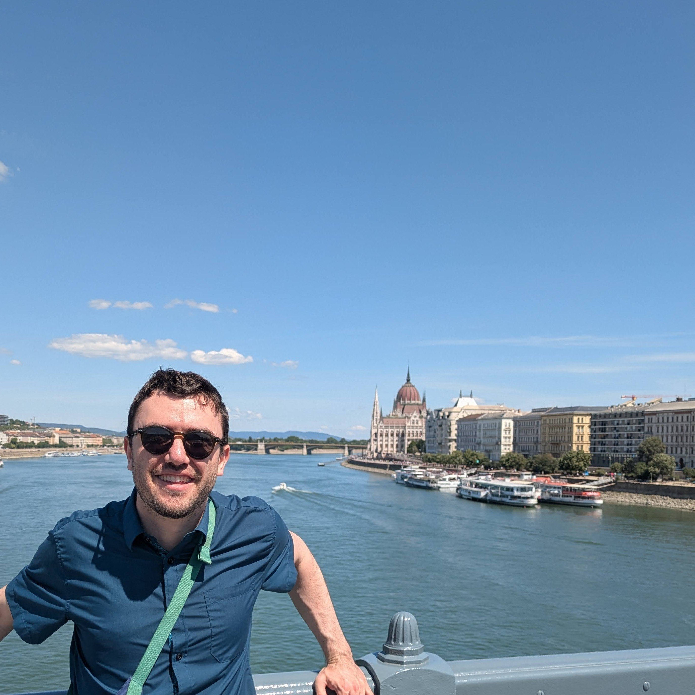

<!-- TODO: copy your photo from the old site to assets/buste.jpg -->
{.portrait alt="Portrait of Ari Rappaport"}

I am a postdoctoral researcher at the [Laboratoire Jacques-Louis Lions](https://www.ljll.fr/) (Sorbonne Université / CNRS) in Paris, funded by an ERC Synergy grant. <!-- TODO: add project name + link -->

My research sits at the interface of **numerical analysis** and **scientific computing**, with a focus on **high-frequency electromagnetic wave propagation in complex and anisotropic media**. I work on **domain decomposition methods** for the time-harmonic Maxwell equations — their design, their wavenumber-explicit convergence analysis, and their large-scale parallel implementation — using **semiclassical analysis** as the framework that explains when and why these solvers work.

Before joining LJLL, I was a postdoc in the [POEMS team](https://uma.ensta-paris.fr/poems/) at ENSTA Paris, working with Patrick Ciarlet, Axel Modave, and Théophile Chaumont-Frelet. I completed my PhD at Sorbonne Université and Inria Paris in the [SERENA team](https://team.inria.fr/serena/), supervised by Martin Vohralík and François Févotte, on adaptive finite element methods and solvers for nonlinear elliptic PDEs.

## Contact

- Email: <!-- TODO: current LJLL email -->
- Office: Laboratoire Jacques-Louis Lions, Sorbonne Université, 4 place Jussieu, 75005 Paris
- [GitHub](https://github.com/aerappa) · [Google Scholar](https://scholar.google.com/citations?user=FIbOGQEAAAAJ&hl=en) · [HAL](https://hal.science/search/index/?q=ari+rappaport) · [LinkedIn](https://www.linkedin.com/in/ari-rappaport-642559108/)
