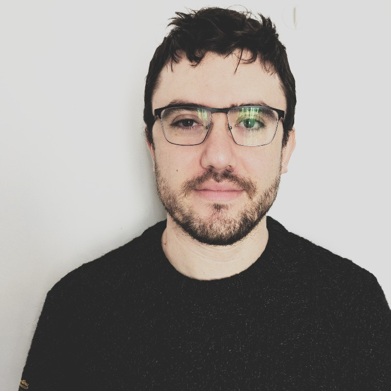

{.portrait alt="Portrait of Ari Rappaport"}

I am a postdoctoral researcher at the [Laboratoire Jacques-Louis Lions](https://www.ljll.fr/) (Sorbonne Université / CNRS) in Paris, working on phase space methods within the ERC Synergy project [PSINumScat](https://psinumscat.com/).

Previously, I was a postdoc in the [POEMS team](https://poems.ensta.ip-paris.fr/) at ENSTA Paris, working with [Marcella Bonazzoli](https://mbonazzo.gitlabpages.inria.fr/), [Patrick Ciarlet](https://perso.ensta-paris.fr/~ciarlet/eng_index.html), [Axel Modave](https://www.axel.modave.eu/), and [Théophile Chaumont-Frelet](https://tchaumont.github.io/) on numerical methods for electromagnetic waves.

I completed my PhD at Sorbonne Université and Inria Paris in the [SERENA team](https://team.inria.fr/serena/), supervised by [Martin Vohralík](https://who.rocq.inria.fr/Martin.Vohralik/) and [François Févotte](https://fevotte.net/), on a posteriori error estimation and adaptive algorithms for nonlinear elliptic PDEs.

## Contact

- Email: [ari.rappaport@sorbonne-universite.fr](mailto:ari.rappaport@sorbonne-universite.fr)
- Office: Laboratoire Jacques-Louis Lions, Sorbonne Université, 4 place Jussieu, 75005 Paris
- [GitHub](https://github.com/aerappa) · [Google Scholar](https://scholar.google.com/citations?user=FIbOGQEAAAAJ&hl=en) · [HAL](https://hal.science/search/index/?q=ari+rappaport) · [LinkedIn](https://www.linkedin.com/in/ari-rappaport-642559108/)
