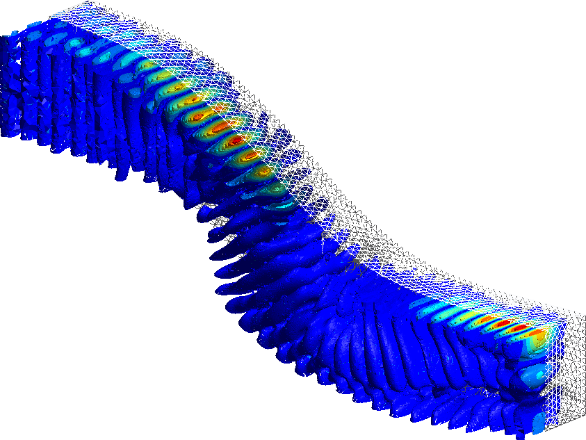

My work develops robust, scalable, and mathematically grounded algorithms for large-scale PDE problems. The through-line is **high-frequency wave propagation in complex media**: domain decomposition as the algorithmic lens, wavenumber-explicit and semiclassical analysis as the explanatory framework, and careful HPC implementation as the proving ground.

## Domain decomposition for anisotropic Maxwell equations

*Current work at LJLL, within an ERC Synergy project.* <!-- TODO: project name, collaborators (Tournier, Spence, Galkowski), links -->

I study **domain decomposition methods (DDM) for the time-harmonic Maxwell equations in anisotropic and heterogeneous media**, motivated by applications such as radar-absorbing materials (RAM). This combines:

- **Wavenumber-explicit convergence analysis** of DDM, connecting solver behavior to semiclassical resolvent estimates and the geometry of trapping;
- **Absorption and impedance modeling** for lossy, anisotropic coatings, where physical phenomena (Salisbury-screen and Fabry–Pérot resonances, birefringence, cross-polarization) directly shape solver performance;
- **Large-scale parallel implementation** in [FreeFem++](https://freefem.org/) / [ffddm](https://doc.freefem.org/documentation/ffddm/index.html), with carefully designed numerical experiments and verification benchmarks.

## Discretizations for time-harmonic Maxwell: the CHDG method

*Relevant work: [Rappaport, Chaumont-Frelet, Modave (HAL preprint, 2025)](https://hal.science/hal-05016261)*

The CHDG method — a hybridizable discontinuous Galerkin method with transmission variables, originally developed for acoustics — had not been extended to the full 3D Maxwell equations. My work provides the first analysis and implementation of CHDG in this setting:

- **A stable hybridizable discretization** for high-frequency electromagnetic fields, enforcing tangential continuity through a hybrid trace variable;
- **Well-posed local elimination**: the elementwise static-condensation systems defining the local fields are provably uniquely solvable;
- **A provably contracting hybrid solver**: the global trace problem admits a contracting fixed-point iteration (in the spirit of the UWVF), with estimates valid in the high-frequency regime;
- **Large-scale validation**: parallel experiments with high-order discretizations at ≈13 million degrees of freedom.

<!-- TODO: copy figures/CGNRprec_1600.png from the old site into assets/ and uncomment:

-->

## A posteriori error estimation and adaptive algorithms

*Relevant work: [Févotte, Rappaport, Vohralík (Comput. Geosci., 2024)](https://link.springer.com/article/10.1007/s10596-024-10309-7) · [Févotte, Rappaport, Vohralík (CMAME, 2024)](https://www.sciencedirect.com/science/article/pii/S0045782523006825) · [Harnist, Mitra, Rappaport, Vohralík (HAL, 2023)](https://hal.science/hal-04033438)*

A recurring theme in my work is the development of **guaranteed a posteriori error estimators** and adaptive algorithms for nonlinear and nonsmooth PDEs:

- **Equilibrated flux estimators for nonsmooth elliptic problems**, giving guaranteed upper bounds on the energy error and separating the contributions of regularization, linearization, and discretization — leading to adaptive stopping criteria for each component;
- **Adaptive regularization** strategies that render nonsmooth nonlinearities amenable to Newton linearization, applying smoothing only where the estimators say it is needed;
- **Richards' equation and porous-media flow**, where these tools yield markedly more robust solvers for degenerate constitutive laws.

The overarching goal is adaptive algorithms that autonomously tune regularization parameters, Newton tolerances, and mesh resolution in response to certified error estimators.

<!-- TODO: copy figures/perched.png and figures/heart_mesh2.png from the old site if you want the illustrations back -->
